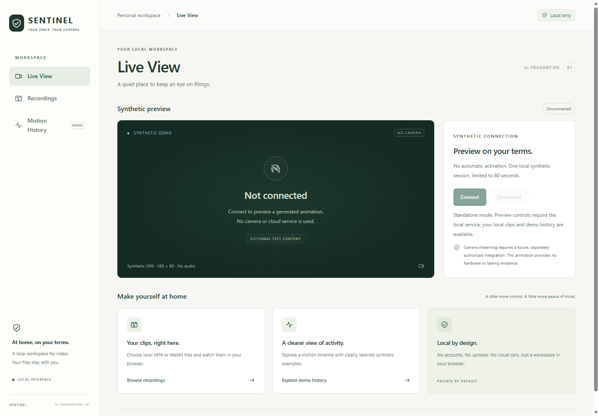
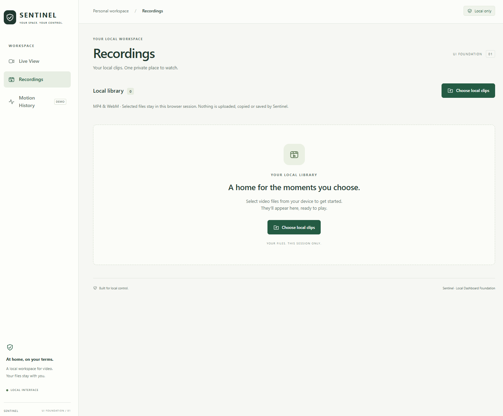
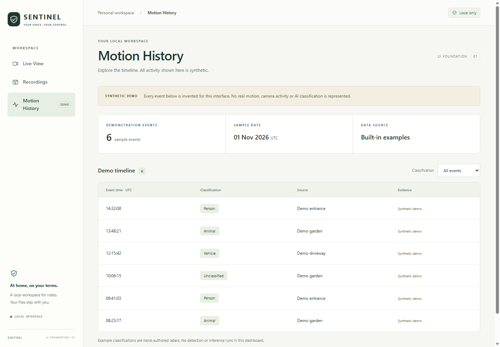

# Sentinel — Local Home Camera Intelligence

**Why I started Sentinel.** Have you ever bought a capable home security camera, only to discover that many of its most useful features are locked behind an expensive monthly subscription? I encountered that frustration myself. The hardware was capable of capturing video, but accessing recordings, retaining footage, and using more advanced motion-detection features could depend on paid cloud services.

That got me thinking: **why should I need to pay a recurring subscription to make full use of hardware I already own?** I wanted to explore whether I could build my own local system to record and manage camera footage, keep control over where that footage is stored, and avoid relying on external cloud services for features that could potentially run on my own computer.

The project quickly grew into a broader idea. Beyond simply storing video, I wanted to investigate how computer vision and AI could help distinguish meaningful activity from routine motion—for example, identifying people, animals, or other events that might actually deserve my attention. Ideally, such a system could provide useful notifications while keeping the underlying recordings and analysis local and private.

**Sentinel** is my attempt to explore that idea through practical software development. It combines my interest in engineering, automation, computer vision, and self-hosted technology, with the longer-term goal of creating a useful, privacy-conscious home camera system without unnecessary subscriptions. The project is being developed incrementally, with synthetic demonstrations and independently testable components used to validate the software before broader hardware integration.

**Portfolio scope.** This is a focused, independently implemented demonstration of selected ideas from a larger private product. It includes Live View with a manually started synthetic preview, Recordings with a session-based local video library, and Motion History with fictional events and labels. Real-camera integration, automatic recording, persistent video storage, local AI classification and full cloud independence remain broader project goals.

## Explore the demo

### Live View

The standalone dashboard shows the **Synthetic Demo / No Camera** label and a disconnected preview. With the local service running, select **Connect** to play the bundled animation and **Disconnect** to stop it. The preview has a 60-second limit, and the client clears playback on expiry or navigation.



### Recordings

Sentinel includes a local video library for viewing clips already stored on your device. Select MP4 or WebM files, browse the selected recordings, and play them directly in the application without uploading them to a server or cloud service.

The library is session-based. Sentinel does not copy, permanently store, or automatically record the selected videos. The demo uses files you choose and runs independently of security-camera hardware.



### Motion History

Filter the six fixed example rows by category. Their labels illustrate the interface. A separate observer abstraction deduplicates synthetic events by stable identity in its tests.



## Run locally

Use Python 3.12 and a browser with VP8/WebM playback. Start the standard-library service from the repository root.

```sh
python3 -B -m sentinel.live_view
```

Open `http://127.0.0.1:8765`. Opening [the dashboard HTML](ui/index.html) directly enables the standalone local video library and timeline, with Connect disabled. Use only the [generated media fixture](sentinel/synthetic_preview.webm) when exercising local clip playback.

## Engineering and methods

- [The preview service](sentinel/live_view.py) binds to loopback and serves a finite, video-only VP8 fixture under a bounded session. [The preview client](ui/live.js) handles manual connection, disconnect, expiry and playback errors. [The fixture generator](tools/generate_preview_fixture.py) draws the frames locally. Pillow is optional and used only to regenerate the fixture.
- [The event observer](sentinel/events/observer.py) defines a deduplication boundary for an injected event source. [The pipeline](sentinel/pipeline.py) and [recorder](sentinel/recording/recorder.py) expose policy and capture interfaces for isolated synthetic tests. The dashboard timeline is a fixed illustration and runs independently of those abstractions.

## Verification

```sh
node --test tests/test_live_view.cjs
node tests/test_dashboard.cjs --mock
python3 -B -m unittest discover -s tests -p 'test_*.py'
```

On Windows, the preview and dashboard harnesses passed seven and eight mocked checks respectively. The Python suite passed 187 tests and skipped 38 POSIX-only tests. In an earlier owner-run check on Ubuntu 24.04 (WSL 2) with Python 3.12.3, all 225 Python tests passed. The owner confirmed that the bundled WebM played in Recordings and the playback timer advanced. The automated Chromium harness stalled before it could run its browser checks.

## Scope and privacy

The demo uses local assets and generated, silent media. Use fictional clips only. Hardware wake, real streaming, unattended recording, local classification and H.264/FFmpeg/MSE transport are outside this snapshot's demonstrated scope. The invented labels and timestamps represent example UI states.
